# KrishiNexus OS

**An edge-to-cloud multi-agent operating system for Bangladeshi smallholder farmers.**
Built for the International AI Builders Congress 2026 · Track: AgriSphere AI → FarmMarket.

A farmer speaks in their own dialect (Rangpuri, Bogura/Varendri, Sylheti, Standard Bangla or Banglish). Four agents grade
the crop, expose the middleman markup, price cold storage against a pooled truck sale, check 72-hour flash-flood risk
and underwrite credit, then reply in spoken Bangla, online or offline at a union kiosk.



---

## Contents

- [Project overview](#project-overview)
- [Recent changes](#recent-changes)
- [Quickstart](#quickstart)
- [Architecture](#architecture)
- [API at a glance](#api-at-a-glance)
- [Evaluation](#evaluation)
- [Repository layout](#repository-layout)
- [What is real and what is simulated](#what-is-real-and-what-is-simulated)

---

## Project overview

| Layer | What it does |
|---|---|
| **FastAPI backend** (`backend/`, port `8000`) | 36 routes; Pydantic v2 schemas throughout; JSON-RPC 2.0 MCP gateway; live agent trace over WebSocket `/ws/agent-trace` |
| **3 MCP servers, 13 tools** | DAM market & syndicate anomaly (4), Open-Meteo weather + Sentinel-1 SAR flood (5), BCSA cold-storage quota & IoT telemetry (4); HTTP, SSE and stdio transports |
| **CRAG pipeline with intent routing** | PII scrub → HyDE dialect rewrite → intent detection → hybrid BM25 + vector retrieval with RRF and reranking → GraphRAG multi-hop facts → Corrective-RAG grading → live MCP augmentation |
| **LangGraph supervisor + 4 agents** | Vision grading, syndicate bypass (5-ton pooled trucks), cold-chain arbitrage (ΔΠ circuit-breaker), climate credit (SAR flood shield + 300–850 score) |
| **Offline edge node** | Bangla voice pipeline, optical grader with signed certificates, local LLM manager for **Ollama** / llama.cpp / vLLM with automatic fallback when no runtime is reachable |
| **Vite + React + TypeScript frontend** (`frontend/`, port `5173`) | A product overview at `/` with one-click live farmer decisions and live MCP cards; the live OS at `/os` (farmer zero-UI app, co-op command center with a Three.js cold-storage twin, market and bank desk); the `/docs` whitepaper with a 13-tool MCP inspector |
| **Docker Compose** | Backend and nginx-served frontend; optional `local-llm` profile adds Ollama and pulls the quantised models |

The system runs end to end with **no paid API keys and no GPU**: every agent has deterministic logic seeded with
Bangladeshi agricultural data (DAM prices, BCSA storage quotas, BARI storage protocols, haor flood history).

---

## Recent changes

### Institutional interface (Phase 8, 24 October 2026)

The site is now a daylight, high-trust product interface. It replaces the earlier 3D scroll story, which hijacked the
scroll wheel. Every figure on it comes from a live call to the running backend.

- **Overview (`/`)**
  - A one-click live decision for Rahim Mia (400 kg potato, Rangpur) or Abdul (Boro rice, Sunamganj haor): the circuit
    breaker blocks the Tk 12/kg Faria offer below the Tk 15/kg cost floor, and the card compares the Faria sale, cold
    storage and the pooled 5-ton truck.
  - Three live cards: the five-tier syndicate markup waterfall, the cold-storage quota held by traders and plant owners,
    and a Sentinel-1 haor flood shield that compares today with the simulated April 2017 surge.
  - The LangGraph pipeline: click a node to see the state it reads and writes, the MCP tools it calls and its timing.
  - The metric pills (RAG faithfulness, the 100-case regression) are computed on load, not typed in.
- **Live OS (`/os`)**
  - A 12-column judge mode: the farmer's phone beside the co-op command centre.
  - The agent trace has a plain-language view for judges and a raw JSON-RPC view.
  - The bank desk shows the loan-to-value maths and verifies HMAC-signed quality certificates.
- **Whitepaper (`/docs`)**: a docs layout with the ΔΠ, Aratdar-take and haor-breach formulas, the 13-tool MCP
  playground, live evaluations and the unit-economics simulator.
- **Navbar on every page**: the backend status, a বাং/EN language toggle and an Online / Offline edge switch that
  sends every farmer request in blackout mode.

The Bangla fonts (Anek Bangla, Tiro Bangla) ship with the site. Typed English questions with plural crop names
("potatoes", "chillies") are recognised.

### Dialect rewriter and cold-storage / quota intents: context precision 1.00

Questions that only *mentioned* cold storage, such as "a loan against potatoes in cold storage" or "the cold storage
rent went up", were being rewritten as questions about storage temperature. The rewriter then searched with the
temperature/humidity query, so the BARI storage-protocol passage outranked the right answer.

- Intents are now detected from the question's own English words as well as the Bangla/Banglish concept lexicon.
  "pre-harvest", "post-harvest" and "after harvest" no longer trigger the harvest-timing intent.
- "Cold storage" names a place. On its own it no longer triggers `STORAGE_CONDITIONS`, which now needs a condition
  word such as temperature, humidity, rot or ventilation.
- New `STORAGE_ACCESS` intent for quota, tariff, rent, cost and space. It fires only when cold storage is mentioned,
  so truck rent stays a transport question. It has its own formal query, HyDE passage and live BCSA quota lookup.
- The Bangla word জায়গা (space) is now part of the concept lexicon.

| Metric (19-question labelled set) | Before | After |
|---|---|---|
| Context precision | 0.9211 | **1.00** |
| Context recall | 1.00 | 1.00 |
| Faithfulness / answer relevancy | 1.00 / 1.00 | 1.00 / 1.00 |
| 100-case regression suite | 100/100 | 100/100 |

A probe of 10 paraphrases outside the eval set puts the right passage first in 9 cases. The remaining miss is
"loan *without* collateral": keyword and hashing retrieval cannot handle negation.

### Also in this round

- The syndicate tool now itemises the Bepari's marketing cost; the Aratdar takes 62.35% of it and spends Tk 0 on grading.
- 66 WFP aggregation centres are seeded as 62 in Cox's Bazar and 4 in Kurigram.
- The distress farm-gate price range is Tk 5–14/kg.
- Brief figures are now in the knowledge base and on `/docs`: crop losses, the cold-storage gap and tariff hike, SAR detection, and the credit partners.

---

## Quickstart

### Docker (recommended)

Requires Docker Engine with Compose v2.24 or later.

```bash
git clone https://github.com/HTanvir0011/KrishiNexus.git
cd KrishiNexus
docker compose up --build
```

| URL | What |
|---|---|
| http://localhost:5173 | Product overview with live decision cards (nginx) |
| http://localhost:5173/os | Live OS: split-screen judge mode |
| http://localhost:5173/docs | Live whitepaper, MCP inspector, evals |
| http://localhost:8000/docs | FastAPI OpenAPI reference |

With a local LLM (CPU works; the first start downloads about 6.7 GB of models):

```bash
docker compose --profile local-llm up --build
```

Optional settings:
- `.env` next to `docker-compose.yml` (see `.env.example`): host ports and the Ollama image tag.
- `backend/.env` (see `backend/.env.example`): application settings. Set `KNX_RECEIPT_SIGNING_KEY` before any shared deployment.

> The compose file is validated against the official compose-spec schema, and the backend is tested with the
> container's start command. A full `docker compose up` on a Docker host is the next verification step.

### Local development

```bash
# backend (Python 3.12+)
cd backend
python -m venv .venv
source .venv/Scripts/activate        # Windows Git Bash; use .venv/bin/activate on macOS/Linux
pip install -r requirements.txt
uvicorn main:app --port 8000

# frontend (Node 20.19+ or 22.12+), in a second terminal
cd frontend
npm ci
npm run dev                           # http://localhost:5173, proxies the API to :8000
```

Smoke test:

```bash
curl http://localhost:8000/mcp/tools
curl -X POST http://localhost:8000/evals/run-regression -H "Content-Type: application/json" -d '{"sample_size": 20}'
```

The first returns `"count": 13`; the second runs 100 cases and should pass all of them.

---

## Architecture

```text
 farmer voice / text (dialect)                    judge / co-op / bank UI (React, Three.js)
            │                                                   │  REST + /ws/agent-trace
            ▼                                                   ▼
   edge node ─ Bangla STT/TTS, optical grader, Ollama ──►  FastAPI gateway (:8000)
                                                               │
              ┌────────────────────────────────────────────────┼────────────────────────────┐
              ▼                                                ▼                            ▼
   LangGraph supervisor                               CRAG pipeline                  MCP hub (JSON-RPC 2.0)
   pii → rag → vision → syndicate →                   HyDE rewrite + intents →       dam-market (4 tools)
   cold-chain ⇄ review → climate-credit → reply       hybrid retrieval → GraphRAG    agri-weather-sar (5)
                                                      → CRAG grade → MCP augment     coldchain-iot (4)
```

Key equations:

- **Net farmer surplus (circuit-breaker):**
  `ΔΠ = [Q(1−λ_rot)·E[P_future] − Q(C_storage + C_handling) − C_transport_storage] − [Q·P_spot − C_transport_market]`.
  A below-cost spot sale is blocked when ΔΠ > 0 and smallholder quota is open.
- **Shelf life:** Q10 model with λ_rot ∈ [0.012, 0.09].
- **Flood risk:** haor breach logistic over SAR backscatter and 72-hour upstream rain.
- **Disease risk:** VPD from the Tetens equation.

The full contracts are in [`AGENTS.md`](AGENTS.md).

---

## API at a glance

| Area | Routes |
|---|---|
| MCP | `GET /mcp/servers`, `GET /mcp/tools`, `POST /mcp/call`, `POST /mcp` (JSON-RPC, SSE), `POST /mcp/simulate-anomaly` |
| RAG | `POST /rag/query`, `POST /rag/graph-traverse`, `GET /rag/stats` |
| Guardrails & optimisation | `POST /guardrails/verify`, `POST /optimization/compress`, `GET /optimization/route` |
| Agents | `POST /agents/orchestrate`, `WS /ws/agent-trace`, `GET /agents/trace-history`, `GET /prompts/registry` |
| Automation | `GET /automation/truck-pools`, `POST /automation/truck-pools/join`, n8n-style `daily-dam-sync` and `hourly-sar-flood-check` |
| Edge | `POST /edge/voice-interact`, `POST /edge/grade-crop`, `POST /edge/verify-certificate`, `GET /edge/local-models`, `POST /edge/local-inference`, `GET /edge/lora-dataset` |
| Evals | `GET /evals/metrics`, `POST /evals/run-regression` |

---

## Evaluation

Metrics are **computed live** by `backend/evals/regression_suite.py`; none are hard-coded.

| Metric | Measured | Target |
|---|---|---|
| Faithfulness | 1.00 | 0.94 |
| Answer relevancy | 1.00 | 0.92 |
| Context precision | 1.00 | 0.95 |
| Context recall | 1.00 | 0.91 |
| MCP JSON-schema validity (22 live calls) | 100% | 99.4% |
| PII redaction recall (12 entities) | 100% | 100% |
| Regression suite (5 categories × 20 seeded cases) | 100/100 | — |

These scores come from deterministic token and intent checks plus a rubric judge, not an LLM judge. The labelled RAG
set has 19 questions, so treat the retrieval scores as measured on a small set.

---

## Repository layout

```text
├── docker-compose.yml          backend + frontend; ollama under profile local-llm
├── AGENTS.md / CLAUDE.md       architecture contract (identical copies)
├── MEMORY.md                   live build state and handover log
├── assets/team_animation.svg   animated team roster
├── backend/
│   ├── main.py  config.py      FastAPI app, settings, multi-LLM router
│   ├── mcp_servers/            3 MCP servers + JSON-RPC hub
│   ├── rag/                    lexicon, knowledge seed, hybrid retriever, GraphRAG, CRAG pipeline
│   ├── agents/                 LangGraph supervisor + 4 agents
│   ├── guardrails/             PII scrubber, financial circuit-breaker
│   ├── optimization/           token compressor
│   ├── prompts/                XML prompt registry + optimiser
│   ├── automation/             durable truck pools, n8n-style jobs
│   ├── edge_node/              voice, optical grader, local LLM manager
│   └── evals/                  metrics engine + 100-case regression suite
└── frontend/
    ├── nginx.conf  Dockerfile  production serving + API/WebSocket proxy
    ├── design/                 redesign plan and style tile (not part of the build)
    └── src/                    story/ (overview and its live cards), os/ (live OS), pages, components, typed API client
```

---

## What is real and what is simulated

Real:
- live Open-Meteo weather;
- all equations and the circuit-breaker;
- hybrid retrieval, GraphRAG and CRAG;
- PII scrubbing;
- HMAC-signed certificates and receipts;
- the durable truck pools;
- the measured metrics.

Simulated or modelled, and labelled as such in the UI and API:
- DAM, BCSA and IoT figures are seeded data, not live feeds;
- YOLO detections (no trained weights ship);
- local-LLM telemetry when no runtime is running;
- the LoRA adapter, whose training dataset is generated but which has never been trained;
- agent replies are deterministic; no live LLM calls are made.

Figures quoted from the project brief, such as the CPD July 2026 study and partner terms, are attributed as cited.
