# KrishiNexus OS

**An edge-to-cloud multi-agent operating system for Bangladeshi smallholder farmers.**
Built for the International AI Builders Congress 2026 · Track: AgriSphere AI → FarmMarket.

A farmer speaks in their own dialect (Rangpuri, Bogura/Varendri, Sylheti, Standard Bangla or Banglish). Four agents grade
the crop, expose the middleman markup, price cold storage against a pooled truck sale, check 72-hour flash-flood risk
and underwrite credit, then reply in spoken Bangla, online or offline at a union kiosk.



---

## Contents

- [Project overview](#project-overview)
- [Recent changes](#recent-changes)
- [Quickstart](#quickstart)
- [Architecture](#architecture)
- [API at a glance](#api-at-a-glance)
- [Evaluation](#evaluation)
- [Repository layout](#repository-layout)
- [What is real and what is simulated](#what-is-real-and-what-is-simulated)

---

## Project overview

| Layer | What it does |
|---|---|
| **FastAPI backend** (`backend/`, port `8000`) | 41 routes; Pydantic v2 schemas throughout; JSON-RPC 2.0 MCP gateway; live agent trace over WebSocket `/ws/agent-trace` |
| **3 MCP servers, 13 tools** | DAM market & syndicate anomaly (4), Open-Meteo weather + Sentinel-1 SAR flood (5), BCSA cold-storage quota & IoT telemetry (4); HTTP, SSE and stdio transports |
| **CRAG pipeline with intent routing** | PII scrub → HyDE dialect rewrite → intent detection → hybrid BM25 + vector retrieval with RRF and reranking → GraphRAG multi-hop facts → Corrective-RAG grading → live MCP augmentation |
| **LangGraph supervisor + 4 agents** | Vision grading, syndicate bypass (5-ton pooled trucks), cold-chain arbitrage (ΔΠ circuit-breaker), climate credit (SAR flood shield + 300–850 score) |
| **Offline edge node** | Bangla voice pipeline, optical grader with signed certificates, local LLM manager for **Ollama** / llama.cpp / vLLM with automatic fallback when no runtime is reachable |
| **Vite + React + TypeScript frontend** (`frontend/`, port `5173`) | A product overview at `/` with one-click live farmer decisions and live MCP cards; the live OS at `/os` (farmer zero-UI app, co-op command center with a Three.js cold-storage twin, market and bank desk); the `/docs` whitepaper with a 13-tool MCP inspector |
| **Docker Compose** | Backend and nginx-served frontend; optional `local-llm` profile adds Ollama and pulls the quantised models; optional `data` profile adds PostgreSQL + pgvector, Neo4j, Redis and n8n, loaded with the app's own data |

The system runs end to end with **no paid API keys and no GPU**: every agent has deterministic logic seeded with
Bangladeshi agricultural data (DAM prices, BCSA storage quotas, BARI storage protocols, haor flood history).

---

## Recent changes

### Buyer bids, 1-tap escrow, truck reroute and data services (Phase 10, 10 November 2026)

- **Buyer bids** (market seat, `/os/market`).
  - Every buyer for the lot is listed, best net payout first: supermarket DCs, wholesale arats, the 66 WFP centres
    and four new agro-processors. The processors (potato flakes and chips, chili paste, a rice mill) buy grades that
    retail refuses.
  - Net payout is after pooled freight, fees and transit loss. Bids under the crop's production cost are flagged.
  - Bids are modelled from DAM hub prices, not live offers from named buyers.
- **1-tap escrow.**
  - One tap locks the best bid. The amount is held for the farmer's bKash or Nagad wallet and released when the
    delivery is weighed at the buyer's door.
  - The node recomputes the bid itself, a second tap returns the same escrow, and the receipt is HMAC-signed with the
    wallet number masked.
  - **The escrow is simulated:** no money moves and no wallet API is called. A live escrow needs a merchant agreement
    and API credentials.
- **Truck reroute on transit heat** (co-op seat, `/os/coop`).
  - The co-op enters the truck's temperature. If the produce would spoil before arrival (ETA over 75% of its
    remaining shelf life), the truck is sent to the best buyer it still reaches in time, and the escrow is locked
    again there.
  - At 38 °C a potato truck keeps its route; a green-chili truck moves from a 7.2 h buyer to a 2.0 h one.
- **Data services in Compose** (`docker compose --profile data up --build`).
  - PostgreSQL + pgvector receives the 19 knowledge chunks with the vectors the app indexes.
  - Neo4j receives the supply-chain graph.
  - n8n runs the two cron jobs in queue mode on Redis.
  - The app itself still answers from its in-process stores. This profile has not yet run on a Docker host.
- **Training update.**
  - Prompts v6 fixed storage citation (0.911 on the exported model) but store-or-sell verdicts fell to 0.895, so that
    model was not shipped.
  - Prompts v7, where the circuit breaker states whether today's price is below the floor, fixed those verdicts
    (1.000 in every check). But storage citation fell to 0.85–0.89 on 14 unseen sentences, so that model was not
    shipped either.
  - The deployed model is unchanged. All results are in `TRAINING_PLAN.md` §6.

### Trained models (Phase 9 training, 8–10 November 2026)

Four models are trained on Kaggle and measured against targets set before training. The notebooks are in
`training/kaggle/` and the measured reports in `training/runs/`. Full write-ups are in `TRAINING_PLAN.md` §6, §8, §8b
and §8c. The weights are not in this repository; without them, the app says so and uses its labelled fallback.

| Model | What it does | Measured on held-out test data | In the app |
|---|---|---|---|
| `krishi-bangla-lora-v2`: Qwen2.5-1.5B + QLoRA, Q8_0 GGUF served by Ollama | Bangla advisor: fair offer, store or sell (with the ΔΠ working), flood alert, storage advice, read from the agents' tool results | 888 questions, deployed file: fair offer 0.988, store or sell 1.000, flood alert 0.955 (1.000 on wordings written separately), storage citation 0.800, **missing its 0.90 target**; on a later fresh batch of 600 storage questions worded about each answer's own subject, 0.933 (0.975 on sentences it never trained on) | yes: offline kiosk answers |
| `yolov11n-krishi-bd-v2.1`: two-stage YOLO11, Diamant Potato Dataset (CC BY 4.0) | finds each potato, then segments scab, rot, greening and damage | finder mAP50 0.994 (target 0.90); defect mask mAP50 0.342, **missing 0.50**; grade accuracy 0.764 (target 0.70) | yes: potato photo grading, with a size warning signed into the certificate |
| `krishi-price-v1`: LightGBM, GRU, TCN and an ensemble, on WFP prices | staple price forecasts 1–3 months ahead, plus margin flags | **misses 2 of 3 targets**; it doesn't beat "no change" overall | yes: shown as indicative only |
| `krishi-whisper-bn-v1`: Whisper Small, Common Voice 13 Bengali | Bangla speech-to-text on the device | word error 0.435 (target 0.45); character error 0.229, **missing 0.15**. Both were measured with a 128-token cap that cut long transcripts; the app's own setup scores 0.335 / 0.110 on 300 test clips | yes: offline, the farmer app records speech and the kiosk transcribes it |

- **Freely worded questions (SFT prompts v5).** 4,800 generated training questions in colloquial Bangla, Rangpuri,
  Bogura, Sylheti, Banglish and English. The test includes 32 wordings written separately, which no model trained on.
  On the same test, the previous model scored 0.414 on flood alerts (1.000 on its own templates). That is the gap v5
  closed.
- **A question router for free-form text.** The router that attaches each question's tool result now reads prices,
  months, rent, rot rates, rain and radar readings in many phrasings. It routes 212 of the 239 held-out-wording test
  questions correctly.

### Datasets, honest evaluation and a leaner OS (Phase 9, 29 October 2026)

- **A frozen blind retrieval test.** `backend/evals/holdout_probe.py` holds 66 farmer questions written blind to the
  retrieval rules — six dialects and surface forms, plus paraphrase, negation and cross-document traps. It is served live
  at `GET /evals/holdout` (cached 10 minutes) and runnable from the whitepaper. Measured 29 October 2026: top-1 **0.500**,
  top-3 **0.848**, against **1.00** on the curated 19-question set — the honest generalisation number. The set is frozen:
  the rules are never tuned against it.
- **A family-aware SFT split.** The generated fine-tuning dataset now has a deterministic train/val/test split (2,301 /
  239 / 660) in which negotiation cells, dialect, timing and region holdouts never straddle splits, with leakage
  assertions on every export. Served through `GET /edge/lora-dataset` and `GET /edge/local-models`.
- **Training plan, not training.** `TRAINING_PLAN.md` documents the 4 GB-GPU QLoRA recipe, the merge-to-GGUF deployment
  route and the adapter eval design. No model is trained yet; the adapter stays labelled `dataset_ready_not_trained`.
- **Leaner OS chunk.** The Three.js cold-storage twin is lazy-loaded, cutting the `/os` entry chunk from 627 kB to 72 kB.
- **Full Bangla OS panels.** The trace, command centre, bank desk, truck map and twin chrome all follow the বাং/EN
  toggle; identifiers, units and technical tokens stay in English.

### Institutional interface (Phase 8, 24 October 2026)

The site is now a daylight, high-trust product interface. It replaces the earlier 3D scroll story, which hijacked the
scroll wheel. Every figure on it comes from a live call to the running backend.

- **Overview (`/`)**
  - A one-click live decision for Rahim Mia (400 kg potato, Rangpur) or Abdul (Boro rice, Sunamganj haor): the circuit
    breaker blocks the Tk 12/kg Faria offer below the Tk 15/kg cost floor, and the card compares the Faria sale, cold
    storage and the pooled 5-ton truck.
  - Three live cards: the five-tier syndicate markup waterfall, the cold-storage quota held by traders and plant owners,
    and a Sentinel-1 haor flood shield that compares today with the simulated April 2017 surge.
  - The LangGraph pipeline: click a node to see the state it reads and writes, the MCP tools it calls and its timing.
  - The metric pills (RAG faithfulness, the 100-case regression) are computed on load, not typed in.
- **Live OS (`/os`)**
  - A 12-column judge mode: the farmer's phone beside the co-op command centre.
  - The agent trace has a plain-language view for judges and a raw JSON-RPC view.
  - The bank desk shows the loan-to-value maths and verifies HMAC-signed quality certificates.
- **Whitepaper (`/docs`)**: a docs layout with the ΔΠ, Aratdar-take and haor-breach formulas, the 13-tool MCP
  playground, live evaluations and the unit-economics simulator.
- **Navbar on every page**: the backend status, a বাং/EN language toggle and an Online / Offline edge switch that
  sends every farmer request in blackout mode.

The Bangla fonts (Anek Bangla, Tiro Bangla) ship with the site. Typed English questions with plural crop names
("potatoes", "chillies") are recognised.

### Dialect rewriter and cold-storage / quota intents: context precision 1.00

Questions that only *mentioned* cold storage, such as "a loan against potatoes in cold storage" or "the cold storage
rent went up", were being rewritten as questions about storage temperature. The rewriter then searched with the
temperature/humidity query, so the BARI storage-protocol passage outranked the right answer.

- Intents are now detected from the question's own English words as well as the Bangla/Banglish concept lexicon.
  "pre-harvest", "post-harvest" and "after harvest" no longer trigger the harvest-timing intent.
- "Cold storage" names a place. On its own it no longer triggers `STORAGE_CONDITIONS`, which now needs a condition
  word such as temperature, humidity, rot or ventilation.
- New `STORAGE_ACCESS` intent for quota, tariff, rent, cost and space. It fires only when cold storage is mentioned,
  so truck rent stays a transport question. It has its own formal query, HyDE passage and live BCSA quota lookup.
- The Bangla word জায়গা (space) is now part of the concept lexicon.

| Metric (19-question labelled set) | Before | After |
|---|---|---|
| Context precision | 0.9211 | **1.00** |
| Context recall | 1.00 | 1.00 |
| Faithfulness / answer relevancy | 1.00 / 1.00 | 1.00 / 1.00 |
| 100-case regression suite | 100/100 | 100/100 |

A probe of 10 paraphrases outside the eval set puts the right passage first in 9 cases. The remaining miss is
"loan *without* collateral": keyword and hashing retrieval cannot handle negation.

### Also in this round

- The syndicate tool now itemises the Bepari's marketing cost; the Aratdar takes 62.35% of it and spends Tk 0 on grading.
- 66 WFP aggregation centres are seeded as 62 in Cox's Bazar and 4 in Kurigram.
- The distress farm-gate price range is Tk 5–14/kg.
- Brief figures are now in the knowledge base and on `/docs`: crop losses, the cold-storage gap and tariff hike, SAR detection, and the credit partners.

---

## Quickstart

### Docker (recommended)

Requires Docker Engine with Compose v2.24 or later.

```bash
git clone https://github.com/HTanvir0011/KrishiNexus.git
cd KrishiNexus
docker compose up --build
```

| URL | What |
|---|---|
| http://localhost:5173 | Product overview with live decision cards (nginx) |
| http://localhost:5173/os | Live OS: split-screen judge mode |
| http://localhost:5173/docs | Live whitepaper, MCP inspector, evals |
| http://localhost:8000/docs | FastAPI OpenAPI reference |

With a local LLM (CPU works; the first start downloads about 6.7 GB of models):

```bash
docker compose --profile local-llm up --build
```

With the data services (PostgreSQL + pgvector on `5432`, Neo4j on `7474`/`7687`, n8n on `5678`, all on `127.0.0.1`;
Redis stays internal):

```bash
docker compose --profile data up --build
```

On the first start, n8n imports the two KrishiNexus cron workflows and tries to switch them on. If it cannot, switch
them on in the n8n editor.

Optional settings:
- `.env` next to `docker-compose.yml` (see `.env.example`): host ports, the Ollama and n8n image tags, and the data-profile passwords (local-demo defaults; set your own for anything else).
- `backend/.env` (see `backend/.env.example`): application settings. Set `KNX_RECEIPT_SIGNING_KEY` before any shared deployment.

> A GitHub Actions workflow (`.github/workflows/docker-smoke.yml`) builds the images on a Linux Docker host and starts
> the default stack and then the `data` profile. Both pass its smoke test:
> - The default stack: health, all 13 MCP tools, the 100-case regression suite, the nginx proxy, and state surviving
>   a backend restart.
> - The `data` profile: PostgreSQL + pgvector and Neo4j hold exactly the backend's knowledge chunks and graph, and n8n
>   has both cron workflows.

### Local development

```bash
# backend (Python 3.12+)
cd backend
python -m venv .venv
source .venv/Scripts/activate        # Windows Git Bash; use .venv/bin/activate on macOS/Linux
pip install -r requirements.txt
uvicorn main:app --port 8000

# frontend (Node 20.19+ or 22.12+), in a second terminal
cd frontend
npm ci
npm run dev                           # http://localhost:5173, proxies the API to :8000
```

Smoke test:

```bash
curl http://localhost:8000/mcp/tools
curl -X POST http://localhost:8000/evals/run-regression -H "Content-Type: application/json" -d '{"sample_size": 20}'
```

The first returns `"count": 13`; the second runs 100 cases and should pass all of them.

---

## Architecture

```text
 farmer voice / text (dialect)                    judge / co-op / bank UI (React, Three.js)
            │                                                   │  REST + /ws/agent-trace
            ▼                                                   ▼
   edge node ─ Bangla STT/TTS, optical grader, Ollama ──►  FastAPI gateway (:8000)
                                                               │
              ┌────────────────────────────────────────────────┼────────────────────────────┐
              ▼                                                ▼                            ▼
   LangGraph supervisor                               CRAG pipeline                  MCP hub (JSON-RPC 2.0)
   pii → rag → vision → syndicate →                   HyDE rewrite + intents →       dam-market (4 tools)
   cold-chain ⇄ review → climate-credit → reply       hybrid retrieval → GraphRAG    agri-weather-sar (5)
                                                      → CRAG grade → MCP augment     coldchain-iot (4)
```

Key equations:

- **Net farmer surplus (circuit-breaker):**
  `ΔΠ = [Q(1−λ_rot)·E[P_future] − Q(C_storage + C_handling) − C_transport_storage] − [Q·P_spot − C_transport_market]`.
  A below-cost spot sale is blocked when ΔΠ > 0 and smallholder quota is open.
- **Shelf life:** Q10 model with λ_rot ∈ [0.012, 0.09].
- **Flood risk:** haor breach logistic over SAR backscatter and 72-hour upstream rain.
- **Disease risk:** VPD from the Tetens equation.

The full contracts are in [`AGENTS.md`](AGENTS.md).

---

## API at a glance

| Area | Routes |
|---|---|
| MCP | `GET /mcp/servers`, `GET /mcp/tools`, `POST /mcp/call`, `POST /mcp` (JSON-RPC, SSE), `POST /mcp/simulate-anomaly` |
| RAG | `POST /rag/query`, `POST /rag/graph-traverse`, `GET /rag/stats` |
| Guardrails & optimisation | `POST /guardrails/verify`, `POST /optimization/compress`, `GET /optimization/route` |
| Agents | `POST /agents/orchestrate`, `WS /ws/agent-trace`, `GET /agents/trace-history`, `GET /prompts/registry` |
| Automation | `GET /automation/truck-pools`, `POST /automation/truck-pools/join`, `POST /automation/truck-pools/{pool_id}/transit-check`, n8n `daily-dam-sync` and `hourly-sar-flood-check` |
| Market | `GET /market/bids`, `POST /market/bids/lock` (simulated escrow), `GET /market/price-monitor` |
| Edge | `POST /edge/voice-interact`, `POST /edge/grade-crop`, `POST /edge/verify-certificate`, `GET /edge/local-models`, `POST /edge/local-inference`, `GET /edge/lora-dataset` |
| Evals | `GET /evals/metrics`, `POST /evals/run-regression`, `GET /evals/holdout` |

---

## Evaluation

Metrics are **computed live** by `backend/evals/regression_suite.py`; none are hard-coded.

| Metric | Measured | Target |
|---|---|---|
| Faithfulness | 1.00 | 0.94 |
| Answer relevancy | 1.00 | 0.92 |
| Context precision | 1.00 | 0.95 |
| Context recall | 1.00 | 0.91 |
| MCP JSON-schema validity (22 live calls) | 100% | 99.4% |
| PII redaction recall (12 entities) | 100% | 100% |
| Regression suite (5 categories × 20 seeded cases) | 100/100 | — |

These scores come from deterministic token and intent checks plus a rubric judge, not an LLM judge. The labelled RAG
set has 19 questions, so treat the retrieval scores as measured on a small set.

---

## Repository layout

```text
├── docker-compose.yml          backend + frontend; ollama under profile local-llm; pgvector, Neo4j, Redis, n8n under profile data
├── AGENTS.md / CLAUDE.md       architecture contract (identical copies)
├── MEMORY.md                   live build state and handover log
├── assets/team_animation.svg   animated team roster
├── backend/
│   ├── main.py  config.py      FastAPI app, settings, multi-LLM router
│   ├── market_bids.py          buyer bids and the simulated 1-tap escrow
│   ├── data_seed.py            seed files for the compose data profile (pgvector SQL, Neo4j Cypher, n8n workflows)
│   ├── mcp_servers/            3 MCP servers + JSON-RPC hub
│   ├── rag/                    lexicon, knowledge seed, hybrid retriever, GraphRAG, CRAG pipeline
│   ├── agents/                 LangGraph supervisor + 4 agents
│   ├── guardrails/             PII scrubber, financial circuit-breaker
│   ├── optimization/           token compressor
│   ├── prompts/                XML prompt registry + optimiser
│   ├── automation/             durable truck pools, n8n-style jobs
│   ├── edge_node/              voice, optical grader, local LLM manager
│   └── evals/                  metrics engine + 100-case regression suite + 66-probe blind holdout
├── training/                   SFT data export (prepare_data.py), Kaggle notebooks (kaggle/), measured run reports (runs/)
├── TRAINING_PLAN.md            recipes, split rules, pre-registered targets and measured results for every model
└── frontend/
    ├── nginx.conf  Dockerfile  production serving + API/WebSocket proxy
    ├── design/                 redesign plan and style tile (not part of the build)
    └── src/                    story/ (overview and its live cards), os/ (live OS), pages, components, typed API client
```

---

## What is real and what is simulated

Real:
- live Open-Meteo weather;
- all equations and the circuit-breaker;
- hybrid retrieval, GraphRAG and CRAG;
- PII scrubbing;
- HMAC-signed certificates and receipts;
- the durable truck pools and their transit-heat reroute rule;
- the measured metrics;
- the four trained models and their test scores (above).

Simulated or modelled, and labelled as such in the UI and API:
- DAM, BCSA and IoT figures are seeded data, not live feeds;
- buyer bids are modelled from DAM hub prices, not offers from named buyers;
- the bKash / Nagad escrow is simulated: no money moves and no wallet API is called;
- potato grading without the trained YOLO weights (they are not in the repo) falls back to classical CV, labelled `classical-cv`;
- local-LLM telemetry when no runtime is running;
- the fine-tuned Bangla model needs Ollama and its GGUF; without them the kiosk answers from a labelled deterministic fallback;
- agent replies are deterministic; no cloud LLM calls are made.

Figures quoted from the project brief, such as the CPD July 2026 study and partner terms, are attributed as cited.
